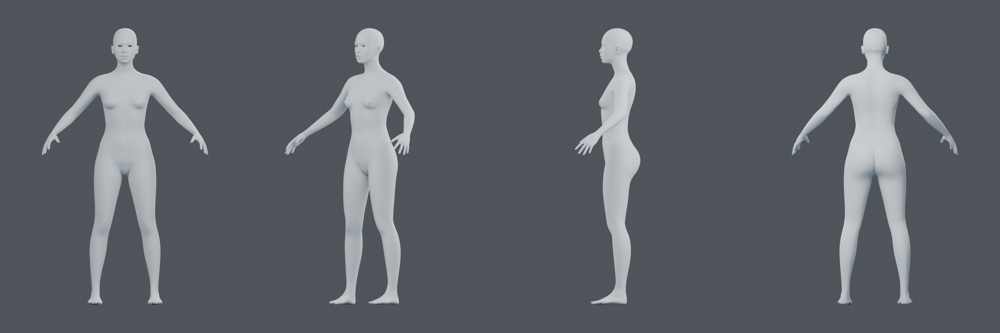
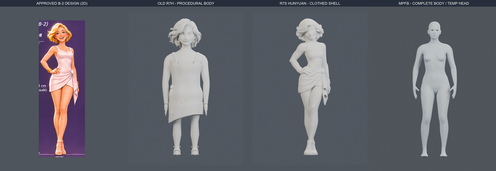

# Issue #53 — MPFB 完整人體與基本骨架候選

2026-11-15，從最新 `dev 1048f50` 開始。**完成一個候選，停止等待 Julia／owner 驗收。** 本輪證明 MPFB 能提供連續完整、可編輯且可用骨骼擺姿的人體；不代表女主角身形美術已獲通過。

## 實際 Blender 畫面

全部本輪人物圖來自 Blender 4.5.13 LTS / Cycles 實際網格渲染，無生成圖片、補畫或換臉。灰色無貼圖材質、相同正交鏡頭及光線；四視圖為同一個 A-pose。臉是 **MPFB 臨時佔位頭**，不是重新設計的女主角身份。

| 檢查 | 實際畫面 |
|---|---|
| A-pose 四視圖 | [正面](a-front.jpg) · [45°](a-front45.jpg) · [真正側面](a-profile.jpg) · [背面](a-back.jpg) |
| 背後 45° | [rear45](a-rear45.jpg) |
| 放鬆站姿 | [正面](relaxed-front.jpg) · [45°](relaxed45.jpg) |
| 真實四邊形線框 | [正面](wire-front.jpg) · [45°](wire-front45.jpg) · [側面](wire-profile.jpg) · [背面](wire-back.jpg) |
| 獨立五指 | [手部特寫](hand-detail.jpg) · [手部線框](wire-hand.jpg) |
| 骨架／關節 | [骨架佈局](bone-layout.jpg) · [肩肘彎曲](joint-shoulders-elbows.jpg) · [髖膝彎曲](joint-hips-knees.jpg) · [回復 A-pose](restored-a.jpg) |

骨架佈局圖以實際 53 根骨頭的 head/tail 畫出八面體，人體半透明僅用於診斷；沒有把這些顯示幾何加入交付人體。

## 與核准設計及先前模型比較

左至右：核准 [B-2 圖](../r7h-revb/approved-b2.png) 的正面裁切、[原始 R7H 展示版](../r7s-image3d/baseline-front.jpg)、[原始 R7S Hunyuan](../r7s-image3d/candidate-front.jpg)、本輪 MPFB 放鬆站姿。前三張沿用既有參考／實際渲染，只做版面等比縮放；未修改任何原始網格。可見高度約略對齊，但舊圖包含頭髮、高跟鞋與洋裝，且姿勢不同，**不能當成相同赤腳人體尺寸的測量**。

- 相比舊程序人體：肩膀到手指、腰腹到骨盆及雙腿是連續表面，不再靠各段圓柱拼接；膝蓋、小腿、腳踝與手指有既有解剖拓樸。
- 相比 Hunyuan：完整骨盆與腹部真正存在於人體內，不是由裙子外殼代替；雙腿、十指可以獨立擺動。Hunyuan 原先的扶腰站姿與裹裙魅力，並沒有被這個技術候選自動繼承。
- **仍需美術判斷：** 肩頸、胸廓及四肢仍偏通用人體，尚未完全達到設計圖的簡潔、俏麗輪廓；佔位頭偏寫實且沒有髮量，不應拿它評判女主角臉部身份。自然站姿只有輕微重心偏移，並非最終展示 pose。這輪沒有為了追求完成感添加服裝或核准頭髮。

## 唯一幾何來源與比例設定

官方 [Blender Extensions MPFB](https://extensions.blender.org/add-ons/mpfb/) **2.0.18**，Blender **4.5.13 LTS**。只使用隨套件提供的 `hm08` 人體、比例 targets、GameEngine rig 和既有權重；未載入任何 R7H、R7T 或 Hunyuan 網格。沒有鏡射切腿、補四肢、voxel 重建、第三方人體或服裝包。

依官方 [basemesh 說明](https://static.makehumancommunity.org/mpfb/docs/assets/basemesh_and_helpers.html)，人體與隱藏的關節／服裝 helpers 共存，比例調整保留同一套拓樸。交付檔保留 MPFB shape keys、helpers 遮罩、骨架及非破壞顯示細分；helpers 不是穿在人身上的衣服。

| MPFB 設定 | 本輪值／目的 |
|---|---|
| Adult female macro | gender 0、age 0.5；臨時頭維持預設 ancestry blend |
| 肌肉／體重／整體比例 | muscle 0.42、weight 0.38、proportions 0.60 |
| 胸廓相關 | cupsize 0.40、firmness 0.58；torso depth decrease 0.06 |
| 肩寬／腰／髖 | shoulder decrease 0.08、waist circumference decrease 0.20、hips increase 0.10 |
| 腿長 | upperlegs height increase 0.12、lowerlegs increase 0.05 |
| 手臂比例 | 左右上臂 horizontal decrease 0.06、前臂 0.03 |
| 身高 | 未細分人體等比設成 1.680 m；顯示細分後實測 1.67768 m |

以上數值是 MPFB target 權重，**不是公分，也不是直接縮放百分比**。人體只建立一次；其後校正的是同一骨架的放鬆姿態與驗收相機，沒有產生第二個人體候選。

## 骨架與技術驗證

使用官方 [GameEngine rig](https://static.makehumancommunity.org/mpfb/docs/characters/rig.html)，53 骨，含十根手指各三段骨頭。選用基本 FK，沒有新增 runtime 物理／動畫系統。

交付 `.blend` 的時間軸保留五個**離線測試姿勢取樣**，不是遊戲動畫：

| Frame | 驗證內容 |
|---|---|
| 1 | MPFB 中性 A-pose，獨立雙腿、手指微張 |
| 21 | 放鬆站姿：輕微骨盆傾斜與位移、膝部承重變化、放下手臂；腳踝維持原落地高度 |
| 41 | 左右肩各額外轉動 20°、左右肘各額外彎曲 40° |
| 61 | 一側髖額外轉動 20°、兩膝各彎曲 30°、腰部扭轉 10°；此為關節測試，非落地站姿 |
| 81 | 回復 A-pose |

重新開啟保存檔後驗證：

- 人體可見網格 **13,380 頂點、13,378 四邊形、26,756 triangles**，單一連通分量；開放邊界 **0**、非流形邊 **0**。
- 全部 13,380 身體頂點都有變形骨權重；權重總和範圍約 **0.99990–1.00000**。
- A-pose 離地 0.20／0.45／0.70 m 的水平截面皆為 **兩個獨立輪廓**，左右範圍不相接。
- 十根手指均有三段骨頭，而且每段皆有實際頂點權重；手指線框與特寫顯示分離指縫。
- 五個保存姿勢保持相同面索引、頂點數及有限座標。Frame 81 與 Frame 1 的最大頂點位移為 **0 m**；沒有斷肢或累積漂移。
- 肩肘、髖膝的指定角度已看實際渲染；這不等同所有極端姿勢、自相交或正式遊戲動畫都已驗證。

## 本機交付及成本

**Blender：** `C:/astra-dev/outrun/art-prototype/output/r7-base/heroine-mpfb-body.blend`

**大小：** 10,518,316 bytes。SHA-256：`150c8fc78d22742231eefe9054e4bad886e85d86ec8871c0171752bf7cae9560`。

同目錄保留 `parameters.json`、`mpfb-human-preset.json`、`inspection.json`、`saved-validation.json`，以及 `create_mpfb_candidate.py`、`pose_and_review.py`、`validate_saved.py`。建立腳本會阻止覆蓋既有候選；正常驗收請直接開 `.blend`。可繼續用 MPFB targets 精修比例；大幅改比例後需重新檢查骨架貼合與權重，不宣稱免驗證。

| 計數範圍 | 數量 |
|---|---:|
| 可見人體編輯網格 | 26,756 triangles |
| 一層非破壞顯示細分 | 107,024 triangles |
| 含隱藏 MPFB helpers 的原始資料 | 19,158 vertices / 18,486 polygons |
| 骨架 | 53 bones |
| GLB／runtime 成本 | 本輪未匯出、未整合，沒有手機效能數據 |
| 額外費用 | NT$0 |

官方 ZIP 放在專案外 `C:/astra-dev/tools/outrun-mpfb/mpfb-2.0.18.zip`；下載 SHA-256 與官方目錄相符：`c075b3e9b94b8e5556a5f03f4653602d02ea306de08126e8f55ed6dee28a2dad`。擴充套件安裝於 Blender 4.5 的 `extensions/user_default/mpfb`。依 [MPFB 官方授權說明](https://github.com/makehumancommunity/mpfb2/blob/master/LICENSE.md)，程式碼為 GPL，隨附人體／targets／rig 等資產為 CC0，官方亦說明輸出不因此變成 GPL；本輪未用第三方資產包。

## 凍結與停止

可玩 v0.10.30 的 `src/`、正式 GLB、五個動作、R6d 金髮、wind、車體、版本號及 main 均未改動。原核准 R7H 母檔、Hunyuan 原檔與失敗 R7T 檔的 SHA-256 與 [來源追查](../r7t-audit/README.md) 相同；正式 race/full/R6d GLB 校驗亦相同。

本輪只將小型報告與圖片提交到 dev；大型 Blender、插件與腳本留本機。沒有洋裝、上色、頭部接合、Hunyuan 推論、遊戲整合、效能測試或 `verify:dev`。

**停止於完整人體基底驗收。** 請先決定人體比例與品質是否成立；本輪未開始獨立 B-2 洋裝。
