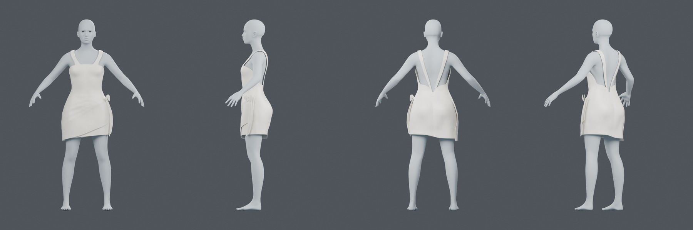
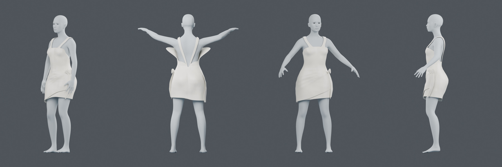

# Issue #54 — MPFB B-2 獨立洋裝候選

2026-11-15，從最新 `dev 932a71f` 開始。**完成一個候選與一次有限貼合修正；服裝美術／變形驗收尚未通過，停止等待 Julia／owner 決定。** 不是可交付遊戲的服裝，也不是已通過的完整女主角。

## 實際 Blender 圖片

全部是 Blender 4.5.13 LTS / Cycles 的真實網格渲染；灰色 MPFB 人體是已核准的底模，臉仍為臨時頭部。沒有接入正式臉部、耳環或 R6d 金髮。所有四視圖使用同一 A-pose、正交相機與光線；沒有補畫模型。

- [正面](front.jpg)、[前 45°](front45.jpg)、[真正 90° 側面](profile.jpg)、[背面](back.jpg)、[背後 45°](rear45.jpg)。
- [自然站姿](relaxed45.jpg)、[跨肩緞帶與後腰接點特寫](back-connections.jpg)。
- [獨立衣物正面](garment-only-front.jpg)、[獨立衣物背後 45°](garment-only-rear45.jpg)、[可編輯四邊形線框](garment-wire-front45.jpg)。獨立衣物圖只暫時隱藏人體供診斷，沒有刪除人體。

## 和核准 B-2 設計比較

對照 [核准 B-2 設計圖的正面／45°／背面](../r7h-revb/approved-b2.png)，以及 [v0.10.30 已接受的遊戲服裝](../r7h-revb/README.md)。它們只作視覺參考，沒有載入其衣物幾何。

| 視角 | 已做出的結構 | 尚未達到設計圖的部分 |
|---|---|---|
| 正面 | 象牙白貼身上衣、腰臀轉折、側腰結與斜向包裹裙襬 | 領口偏簡單；側結像小蝴蝶結，缺少設計圖的自然聚褶；胸腰摺痕仍偏弱 |
| 前 45°／側面 | 真正立體外層裹片與短裙內層；布料有厚度 | 肩帶與背部之間有可見間距；裙側有僵硬邊緣，站姿仍不能稱為完成的展示品質 |
| 背面／後 45° | 兩帶由前胸跨肩往後腰收攏，無繞頸／X／橫向背帶，下背與腰部覆蓋 | 上衣側緣離身；後腰接縫與後裙褶皺不夠精緻；後裙襬比較平直 |

## 變形檢查：保留失敗證據

| Blender frame | 測試 | 結果 |
|---|---|---|
| 1 | A-pose | 可以閱讀 B-2 大結構，仍有肩帶／側緣離身，非最終貼合 |
| 21 | 沿用人體母檔自然站姿 | 局部衣料進入上胸表面；未通過穿模檢查 |
| 101 | 雙上臂相對 A-pose 抬高約 65°、肘彎約 20° | **腋下布料被上臂權重拉成翅狀，明顯失敗**；接點仍連著不代表變形正確 |
| 121 | 脊椎分段共約 15° 輕微轉身 | 整件會隨骨架轉動，未見大型破面；仍有原本的離身問題 |
| 141 | 髖約 8°、膝約 15° | 通過這個小幅度的目視檢查；不代表坐姿或大幅動作可用 |

動作原圖：[抬手正面](raised-front.jpg)／[背面](raised-back.jpg)、[轉身正面](turn-front.jpg)／[背面](turn-back.jpg)、[屈膝側面](knee-profile.jpg)。沒有製作五個遊戲動作。

[近表面檢查資料](pose-clearance.json) 在自然站姿找到 632 個細分後衣物頂點落在人體最近表面的負法線側超過約 1mm；最近人體區域屬 `spine_03`，最大距離約 0.0385 模型局部單位（依既有縮放約 4cm）。其餘四個測試姿勢這項計數為 0。**這不是完整碰撞偵測，也不能檢查過度離身／翅狀變形，不能將 0 當作服裝通過。**

## 實際技術與來源

沿用已安裝的官方 MPFB 2.0.18。先讀並實際嘗試 [MakeClothes 官方流程](https://static.makehumancommunity.org/mpfb/docs/assets/creating_clothes.html) 及 [basemesh/helpers 說明](https://static.makehumancommunity.org/mpfb/docs/assets/basemesh_and_helpers.html)。本輪方法是 **MPFB helper 表面作貼合參考 + 自製 Blender 衣片 + MakeClothes 對應與蒙皮權重**，不是 MakeClothes 自動設計洋裝。

1. 從同一人體使用官方 `ObjectService.extract_vertex_group_to_new_object` 擷取當前形態的 `helper-skirt`（720 verts / 684 quads）與 `helper-tights`（2,674 verts / 2,650 quads）。留在隱藏來源 collection，沒有重建人體。
2. Blender Python 依實際 helper 表面查詢位置，製作可編輯四邊形上衣／裙底；額外建立跨肩布帶、裹片、側結與垂布的衣物拓樸。這是本輪新製的服裝幾何；未讀入舊 R7H 或 Hunyuan 網格。不是人工逐點雕刻或布料模擬。
3. MakeClothes 匹配前的獨立衣物檢查全部通過（全四邊形、無孤立點、每點一個匹配群組、群組與人體一致）。執行 `create_mhclo_from_clothes_matching`，再由 `ClothesService.interpolate_weights` 轉移既有骨架權重並正規化。
4. 最終 `B2 dress - independent MakeClothes-fitted garment` 是獨立 mesh，與人體共用 53-bone rig。兩肩帶前後端各與上衣共用 5 個頂點，並非僅放在背上的飄浮飾物。裹片／側結／垂布是同一衣物 object 內的獨立表面島，以接觸／重疊呈現接縫，**並非所有布片都焊成單一封閉曲面**。
5. 一次有限修正調整上衣側領口、肩帶到後腰路徑及裹片腰部厚度。曾試全衣物 `Shrinkwrap / Outside Surface`，但它將裙身也投影到腿部，破壞裙子空間，因此移除；修正 Solidify 的尖角增厚問題。最終只有 **Armature → Subdivision 2 → Solidify**，不包含 Shrinkwrap 或新衣物物理框架。

**本輪明確限制：** 自動匹配／權重轉移有成功，但不能直接得到合格服裝蒙皮。兩側各有 223 個衣物頂點受上臂骨影響，另有 132 個受 neck、86 個受 head 影響；在此設計下需要有針對性的權重繪製。抬手翅狀變形是本候選的權重／貼合失敗，不是 MPFB 無法做衣服的結論。本輪停止，不再追加候選或接入頭髮來掩蓋問題。

## 檔案、網格與成本

- 原人體（保留）：`C:/astra-dev/outrun/art-prototype/output/r7-base/heroine-mpfb-body.blend`
- 新衣物版本：`C:/astra-dev/outrun/art-prototype/output/r7-clothing/heroine-mpfb-b2-dress.blend`
- 本地製作紀錄：同目錄 `build_dress.py`、`fit_review.py`、`fix_modifier.py`、`audit_final.py` 及各自 log。`fit_review.py` 記錄過被撤回的 Shrinkwrap 嘗試，最終結果必須以新 `.blend`／`fix_modifier.py` 為準，不能單獨重跑該舊嘗試。
- 同目錄 `b2-fitting.mhclo` 是貼合修正前的中間對應檔，**不是完整可散布的最終 MakeHuman 衣物套件**。
- 新 Blender 檔：**11,711,909 bytes（約 11.17 MiB）**；包含完整人體、骨架、隱藏 helper 與渲染場景，非衣服單獨大小。SHA-256：`34720d3f07a9521c14a121b1f21c53f46d0f88cd38ceff0cec0e8c7f697c8227`。

| 成本／檢查 | 數值 |
|---|---:|
| 衣物可編輯頂點 | 4,116 |
| 衣物四邊形 | 3,842 |
| 衣物基礎 triangles | 7,684 |
| 展示細分＋厚度後 triangles | 250,256 |
| 共用骨架 | 53 bones；沒有新增骨頭 |
| 無骨骼權重的衣物頂點 | 0 |
| 每點有效骨骼權重和 | 0.99999995–1.00000005 |
| 衣物材質 | 1，無貼圖／透明髮卡／新增框架 |
| GLB／runtime draw calls／FPS | 未匯出、未整合、未測量 |

完整 [網格與權重稽核](mesh-audit.json)。`Panel - …` 群組供選取布片用，不是骨頭；權重檢查只計入實際骨名。展示細分面數高，尚未做遊戲輕量化。

## 保留與交付界線

原 MPFB 母檔 SHA-256 仍為 `150c8fc78d22742231eefe9054e4bad886e85d86ec8871c0171752bf7cae9560`。另外逐項比較新舊人體頂點、面、所有 shape-key 座標與原始 vertex-group 權重，資料雜湊相同：`9da2262df31937edd58f64a02a8f809f0c78f3e924fedfdbf3e8c5228afa2a0b`。人體沒有刪除被衣服遮住的皮膚或骨盆；原母檔沒另存覆蓋。

凍結資產 SHA-256 也保持原值：

- race GLB：`9314e2694e098b57e8f8731382f36b1fb7bab3c7a879b7a7b6da354b22af78d0`
- full GLB：`8b17cc773798f2f017a810061745e30639f314b38f9d0bedccb1aef2220e6e95`
- R6d hair：`8273fe14b4f1c83a4c8b574bacd7d834a6142380013e6e8ebb6f7b447399f519`

額外支出 NT$0。只推送本目錄的小型報告、數據與 JPG；Blender 母檔留在本機。未修改 `src/`、正式資產、版本號或 `main`；依本輪 Blender-only 指示未執行 `verify:dev`，未觸發手動 CI。**目前交付為可供決策的失敗／部分成功證據，等待 Julia／owner 驗收，不自動進入臉部、髮型或遊戲整合。**
