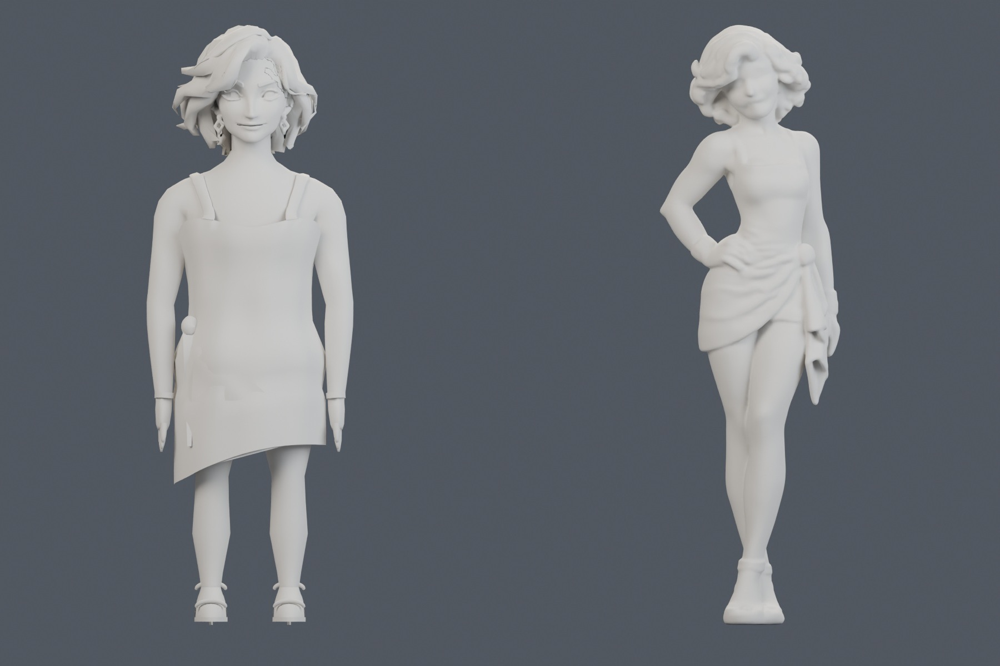

# R7S：一次本機 Hunyuan3D-2.1 全身素模實驗

2026-11-15；依更新後的 [Issue #52](https://github.com/michael-wang/OutRun/issues/52)，在 `68c4093` 的 dev 上執行。**一次 Shape-only 推論已完成，停止生成，待 Julia／使用者驗收。** 軀幹、腰臀與裹裙輪廓比原始程序模型自然，但腿部黏合、手鞋細節融合、B-2 背帶重建錯誤，因此不能視為完整人體或服裝驗收通過。

## 實際 3D 證據

所有 candidate 圖均為實際生成網格在 Blender 4.5.13 的 Cycles 渲染，不是補畫的概念圖。比較圖**左為原始 R7H B-2 全身母檔、右為本輪生成**。兩者統一灰材質、燈光、正交鏡頭及可見高度；原始模型中性站姿與輸入圖扶腰站姿不同，不能將姿勢差異全歸因於人體品質。

| 檢查 | 圖片 |
| --- | --- |
| 正面及設計輸入 | [前後比較](compare-front.jpg)、[設計與生成](reference-vs-shape.jpg) |
| 45° | [前後比較](compare-left45.jpg)、[左 45°](candidate-left45.jpg)、[右 45°](candidate-right45.jpg) |
| 真正側面 | [前後比較](compare-side.jpg) |
| 背面 | [前後比較](compare-back.jpg) |
| 真實拓樸 | [線框比較](compare-wire.jpg)、[膝腿局部線框](candidate-wire-knee-detail.jpg) |

## 美術結果與限制

- **改善：** 胸廓到腰部的收束、腰臀過渡與大腿體積較自然；扶腰姿勢與重心偏移可讀，裙身有裹布褶皺與側腰垂片。側面也有胸、腹、臀的體積變化。
- **主要失敗：** 膝蓋到腳踝多處融合，雙腿無法獨立活動。這不是投影遮擋：距地約 0.20–0.60m 的水平網格截面只有一個輪廓，0.70m 才出現兩個，見 [截面檢查](leg-sections.json)。膝蓋解剖仍不清楚。
- **手腳：** 扶腰手與身體黏接、手指模糊；垂手接近手套，鞋跟／鞋帶融合為厚實塊狀，不能視為可用手腳。
- **服裝：** 正面裹裙方向與腰線比舊版合理，但背面未正確生成 B-2 的跨肩至後腰緞帶及露背開口。前視圖缺乏背面資訊，此次模型未滿足完整 B-2 剪裁。
- **身份：** 新頭部與頭髮僅供全身比例參考，臉部模糊、髮型不等同核准版本；不得替換原有臉部或 R6d 金髮。本輪沒有進行頭部接合。

結論：本次支持「影像生成可帶來更自然的身形與布料整體輪廓」，但**尚未證明能直接取得可供後續製作的完整全身模型**。已停止，沒有第二次推論、手工補身體、上色、retopology、骨架或遊戲整合。

如下一輪獲授權，僅建議先改善輸入：使用同一已核准 B-2 設計的高解析完整正面，雙腿明顯分開、雙手稍離軀幹，降低單張圖遮擋歧義。本輪未製作或執行此替代輸入，背面緞帶仍需另行驗證。

## 輸入與方法

使用 `docs/art-review/r7h-revb/approved-b2.png`，SHA-256 `f6f31f2be9cb268a0e814ce4e0ab23b2921dee00f71829ff8d8d6eed8f9ef781`。裁切第一個完整正面站姿，座標 `[389,0,555,495]`；保留腳部，排除文字與其他視角。以色差遮罩及連通區移除紫色背景，保留原圖 RGB，沒有重繪身形或衣服。

實際人物來源只有約 **140×484 pixels**，放大至透明 1024 方圖不會增加細節；併腿與扶腰遮擋是本次已知輸入限制。[輸入預覽](input-preview.jpg)、[處理及 checksum](input.json)。推論 PNG SHA-256：`e6c06c9783a0d2e2abc34bf5664dc3b87559242f4a37f9487742e8fec7fef8a1`。

重用 `C:/astra-dev/tools/outrun-h1ar3d/venv`、既有 Hunyuan3D-2.1 Shape-only 程式與 `model.fp16.ckpt`。離線載入，沒有新安裝、權重下載、付費服務或 PBR 推論。種子 42、40 steps、guidance 5、octree 384、num_chunks 6000、FP16、FlashVDM marching cubes。新 launcher 以 `attempt.json` 阻擋重複執行。

只清除已知 marching-cubes 的重複索引退化面；沒有刪除人體部分，沒有細分、平滑幾何或重新建構人體。Blender 的 smooth shading 僅影響法線顯示。匯入後只有整體等比縮放與平移，對齊原始模型的 1.67465m 可見高度；不是宣稱赤腳身高量測。

## 成本與檔案

| 項目 | 實測 |
| --- | --- |
| GPU | 本機 RTX 5070 Ti 16GB |
| 載入至原始 GLB | 46.02 秒 |
| PyTorch peak allocated / reserved | 7.66 / 8.02 GiB（不是全機顯存用量） |
| 原始輸出 | 402,268 面，其中 171,808 面為重複索引退化面 |
| 清理後 | 115,228 vertices / **230,460 triangles** |
| GLB | **4,149,160 bytes**，無貼圖、無 rig |
| Blender | **5,260,382 bytes**，含可編輯網格與展示場景 |
| 額外支出 | NT$0 |

獨立實驗目錄：`C:/astra-dev/tools/outrun-r7s-3d/`。大型模型未提交 Git。

- `front-rgba.png`：實際透明輸入。
- `raw.glb`：未清理原始輸出。
- `heroine-standing-candidate.glb`：可匯入的清理版本。
- **`heroine-standing-candidate.blend`：本輪可編輯 Blender 素模。**
- `prepare.py`、`infer.py`、`clean.py`、`render.py`：本次輸入、推論、清理、真實渲染流程；不要再次啟動推論。
- [metrics.json](metrics.json)、[geometry.json](geometry.json)、[checks.json](checks.json)：耗時、成本、SHA-256 與驗證。

## 保護與驗證

Blender 重新開檔及進入 Edit Mode 成功；頂點均為有限數、網格封閉、非流形邊 0。**拓樸可編輯不代表人體正確**，腿部融合仍是主要缺陷。

原始 `art-prototype/output/r7h-heroine-fullbody.blend`、R7H race/full GLB、R6d hair GLB 的前後 SHA-256 相同，詳見 checks.json。沒有修改 `src/`、`public/assets/`、五個動作、臉部、wild 風場、1.0 人物比例、鏡頭或 main；遊戲維持 v0.10.30。僅提交此報告、實際渲染圖與小型量測紀錄。依本輪範圍未執行 `verify:dev`、未增加版本號。

本次不是公開發行或授權審核；沿用 [零費用管線文件](../../COAST_CHARACTER_ZERO_COST_3D_PIPELINE.md) 的模型授權待審紀錄。完成後停止，等待 Julia 與使用者決定是否值得下一步。
