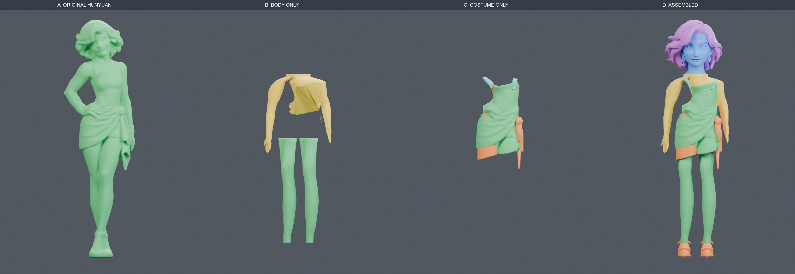

# R7T 來源追查：停止製作，等待 owner / Julia 決策

2026-11-15；依 [Issue #52 的停止與來源驗收指示](https://github.com/michael-wang/OutRun/issues/52#issuecomment-6882983674)。本報告是失敗原因診斷，不是修補完成版或美術通過聲明。

**混用舊程序模型的疑慮成立。** 我把 Hunyuan 的軀幹／上臂與舊 R7H 程序式前臂、手掌、鞋及部分衣料組合。雙腿不是舊程序腿，但被切分、鏡射、拉直及重取樣，已明顯損失原始候選的自然形體。這個做法沒有保住使用者要求的身體基底，責任在本輪整合方式。

## 來源分色實際 Blender 畫面

以下是開啟保留的工作檔後，使用 Blender Cycles 真實網格渲染的診斷圖；不是 AI 圖，也不是新的完成版。來源材質只在記憶體中覆寫，沒有存回任何模型。相同正交鏡頭、光線、AgX、900×1200、24 samples。原始 Hunyuan 僅做展示用等比尺寸／朝向對齊。

| 顏色 | 意義 |
|---|---|
| 綠 | Hunyuan 來源或其衍生幾何；**不代表未加工**，尤其雙腿 |
| 黃 | 已重取樣合併的混合身體：Hunyuan 軀幹／上臂 + 舊程序前臂／手掌 |
| 橙 | 舊 R7H／B-2 程序幾何：鞋、貼合衣身／裙片、腰結／垂帶 |
| 藍 | 已核准頭部及耳環 |
| 紫 | 凍結的 R6d 頭髮 |
| 青 | R7T 新做的立體跨肩緞帶 |

黃色物件經 voxel 合併後，原始頂點索引已消失，不能誠實地逐頂點精確劃分兩種來源；因此整個混合物件標黃，來源由保留的建構腳本交叉確認。

| 檢查項目 | 正面 | 背後 45° |
|---|---|---|
| 原始 Hunyuan | [front](original-hunyuan-front.jpg) | [rear45](original-hunyuan-rear45.jpg) |
| 移除服裝、頭髮、頭部及鞋的形體檢查 | [front](body-only-front.jpg) | [rear45](body-only-rear45.jpg) |
| 洋裝單獨檢查 | [front](costume-only-front.jpg) | [rear45](costume-only-rear45.jpg) |
| 完整組裝 | [front](assembled-front.jpg) | [rear45](assembled-rear45.jpg) |

**身體圖顯示沒有連續的裸身腰臀／骨盆。** Hunyuan 是穿衣的單一表面；本輪把部分表面當衣服切出，並沒有得到衣服底下完整的人體。外觀看似腰臀的部分，大量存在於綠色衣服外殼，而非獨立身體中。

## 逐部位來源

來源 A：`C:/astra-dev/tools/outrun-r7s-3d/heroine-standing-candidate.glb`，R7S Hunyuan 全身素模，230,460 triangles。原檔未修改。

來源 B：`C:/astra-dev/outrun/art-prototype/output/r7h-heroine-fullbody.blend`，既有 B-2 全身母檔。其 `heroine-body` 保存了已核准頭部，以及歷史 `scripts/blender/build_r7h.py` 產生、再由 `scripts/blender/revise_r7h_revb.py` 修訂服裝的程序幾何。

| 部位 | 本輪實際來源／處理 |
|---|---|
| 頭部、眼睛、耳環 | B 的已核准頭部切出；上部頂點位置與顏色比對相符，沒有使用 A 的新頭取代身份 |
| 髮型 | B 的 `blender-blonde-spring`／R6d；展示版靜態 rest 幾何與原始世界座標、顏色相符，未重新設計 |
| 頸部、軀幹、肩膀 | A 的表面切除新頭並接近核准頭部；衣身拆出後只留下截斷上軀幹，未建立完整裸身腰臀 |
| 上臂 | A 的上臂；以局部位置遮罩調整姿態，再與舊前臂合併重取樣 |
| 下臂、手掌、手指 | **B 的舊程序幾何**；從 T pose 的外側手臂範圍切出，再旋轉、伸縮對準候選的肘／腕位置 |
| 腰臀 | A 的穿衣腰臀輪廓主要保留於外層衣料；內側又疊加 B 的貼合裙片，沒有完整獨立裸身骨盆 |
| 大腿、膝部、小腿、腳踝 | A 的同一段前側腿面，切分／鏡射補面後製成左右腿，再拉直、伸縮、封口及 2 mm voxel 重取樣；**非直接保留原本左右腿，也非 B 的舊腿** |
| 腳、鞋底、鞋跟、鞋帶 | **B 的舊程序幾何**，取低於約 0.145 m 的部分，再對齊重建腿的腳踝 |
| 洋裝外層皺褶／包覆 | A 的衣服表面切出，保留部分側腰及不對稱外層輪廓，但切割邊界有破損 |
| 洋裝內層衣身／裙片、腰結、垂帶 | **B 的舊 B-2 程序衣料**，重新貼合並與 A 外層疊合；不是純粹由新素模重建的服裝 |
| 兩條跨肩緞帶 | R7T 新建的有厚度曲面帶；不是 A 原生幾何，也不是頭髮／人體的一部分 |

本輪沒有重新執行 `build_r7h.py`，但**重用了它已產出的幾何**。不重新執行腳本，不能視為沒有使用程序人體。

## 雙腿黏合究竟怎麼處理

目前保存版本的 `build.py` 第 80–135 行記錄：從 A 複製腿區，裁到展示座標約 z=0.205–0.705 m；以穿過 `(0.025, 0.440, 0)`、法向 `(-0.65, 1, 0)` 的平面及 x 邊界取出前側腿面；鏡射補出另一側，合併切邊。兩腿都取自這同一段表面，重新擺到左右位置。

接著把高度改為 `z = 0.12 + (z - 0.205) * 1.36`，調整上端、腿寬／深度及腳踝，封口並以 2 mm voxel 重取樣。這不是只把黏連區分開；它重建了腿部內側及站姿，削弱原有膝蓋、小腿和左右不對稱關係。畫面中的圓柱感與這些處理相符，不能歸因為 Hunyuan 原始腿就是如此。

## 斷裂與破面原因

1. **拼接來源與缺面：** 用位置閾值刪面來分離黏住的手／衣服，也切掉相鄰皮膚與布料。舊前臂／手掌對接到 Hunyuan 的近似肘腕位置，沒有可靠共用接縫。
2. **局部座標／姿態變換：** 最早腳本把上臂轉向新的肘位置，卻未一致處理新舊段長，容易留下肘部落差；另把 neutral 變形套到 `hands[1]`，而需要一起移動的是 `hands[0]`，形成手掌錯位。這是製作腳本的局部變換問題，不是遊戲動畫。
3. **不相容的邊界：** 接縫串連不同數量／形狀的邊界，產生拉長、折疊的三角面；混合皮膚與衣服的廣泛位置遮罩也扯動了不該移動的區域。裙身切口、內外層裙片、裙襬厚度沒有共同邊界，留下薄片、破口和互相穿插。
4. **後續封口沒有解決造型：** 停止前的 voxel union 能封住部分邊界，卻保留碎片及不自然封面。現存 neutral／relaxed 上身各有 **54 個連通分量**；raw mesh 即使邊界數為 0，也不等於人體完整或接縫正確。

目前檔案的物件 scale 均為 `(1,1,1)`，座標／法線為有限數值，展示物件沒有啟用 Armature modifier。故沒有證據把這次破損歸因於 runtime 骨骼、遊戲左右座標或 GLB 匯出。頭髮／頭部原有的開放邊界不能混算成這次新增破損；服裝未套厚度前的正常邊界，也不能一律當成缺面。

### 歷史證據的限制

[最早破損正面](interim-front.jpg)、[最早破損背面](interim-back.jpg) 與 `test-results/r7t/build-initial.py` 已保留。**最早截圖所對應的 `.blend` 曾在停止前被後續工作覆寫，沒有獨立保存。** 現存保留檔包含停止前的修補，因此不是那張初始截圖的逐位元快照；上述早期變換原因以腳本及截圖交叉判讀，沒有重新執行建模來假造歷史現場。

## 保留檔案與校驗

本輪待檢查失敗檔另存：

`C:/astra-dev/outrun/art-prototype/output/r7t/heroine-r7t-failed-preserved.blend`

原工作檔 `C:/astra-dev/outrun/art-prototype/output/r7t/heroine-r7t-showcase.blend` 同樣保留。兩者 SHA-256 均為：

`e3cf7695a99e503aeb7a07eaa50704bff48025e6e8df1e5a283608dde6070c75`

| 凍結來源 | SHA-256 |
|---|---|
| Hunyuan candidate GLB | `58239c868d062488f9259616c98cdf03939a9032ecd55a938a226dfbf6c4e456` |
| R7H B-2 原 Blender 母檔 | `fc26a84cec7e83cf6f30c19348700b692978ebf5d82435b86dfdf31d1534830b` |
| 正式 race GLB | `9314e2694e098b57e8f8731382f36b1fb7bab3c7a879b7a7b6da354b22af78d0` |
| 正式 full GLB | `8b17cc773798f2f017a810061745e30639f314b38f9d0bedccb1aef2220e6e95` |
| R6d GLB | `8273fe14b4f1c83a4c8b574bacd7d834a6142380013e6e8ebb6f7b447399f519` |

本機追查腳本／資料：

- `C:/astra-dev/outrun/test-results/r7t/build-initial.py`：早期製作腳本。
- `C:/astra-dev/outrun/art-prototype/output/r7t/source/build.py`：停止前最後製作腳本；**不要當作核准重建方案執行**。
- `C:/astra-dev/outrun/art-prototype/output/r7t/source/diagnose-readonly.py`：本次只讀檢查與來源分色渲染。
- `C:/astra-dev/outrun/test-results/r7t-audit/geometry-inspection.json`：物件、拓樸、變換及 modifier 原始檢查結果。

## 本輪停止範圍

只開檔檢查、暫時來源分色及輸出診斷圖片／報告；沒有修改模型、重新推論 Hunyuan、重新匯出模型或替換遊戲資產。可玩的 v0.10.30、`src/`、正式 GLB、版本號與 main 均保留。未執行完整遊戲測試、build 或 `verify:dev`，因為這輪沒有遊戲變更。

此前本機 `docs/art-review/r7t/` 的製作報告不構成驗收通過，未提交；以本診斷取代其完成度敘述。完成來源追查後停止，等待 Julia 與 owner 決定是否及如何重建。
