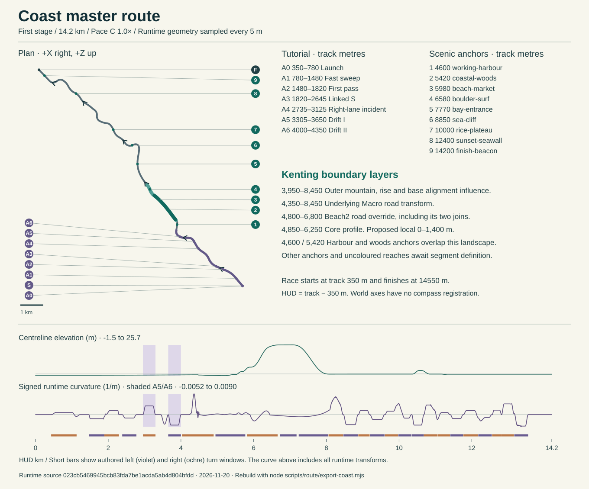

# 海濱公路 R0 · 現役路線與場景責任

**供 Michael / Julia 審閱。** 現役賽道仍全長 14,200 m。墾丁的道路核心是 1,400 m，但光是進場山勢與外層道路回接就橫跨約 4,500 m。把「Beach Market 5980」換成可移動的錨點，仍會留下原處的山、路、浪與護欄。R1 的第一個決策是哪些舊位置要一起帶走、哪些要在新場址重接。

[全程俯視與剖面](coast-master-route.svg) · [每 5 m 的現役取樣 CSV](coast-profile.csv) · [墾丁入口／出口草案](kenting-ports.json) · [相容性規格與示例](connector.md) · [R1 建議與 R0 驗證](verification.md)

**讀圖。** track 為沿賽道的站號，HUD = track − 350。起點 350、終點 14550 分別對應 HUD 0、14200。章節區間使用相對起點里程，教學區間和 hero 位置使用絕對站號。舊內容偶以「HUD metres」稱呼後者。本文除明列 HUD、局部 s 或實際弧長處外，數字均為 track m。圖上的 X/Z 是遊戲世界軸，Y 是海拔；站號差與中心線的世界弧長在回接段可能不同。

**來源。** Julia 在 2026-11-17 留下的《極速漫遊_海濱公路_全賽道俯視圖_20261117.svg》已找到並由協作端核對。圖內版本 6dc92b84，382,199 bytes，SHA-256 `2f42ff2799ac419e6055d5e79acf92816a9059e649bff53101aefac73f61b099`。它記錄新 Macro 套用前的道路。此處另從 2026-11-20 的 `023cb5469945bcb83fda7be1acda5ab4d804bfdd` 實作重建現役圖，保留兩代來源的區別。

## 四個單元

| 單元與成熟度 | 現有核心與可見物 | 影響範圍與重疊 | 可能的銜接責任 |
|---|---|---|---|
| Tutorial · 可玩、規則依站號 | 350–4350。A0–A3 在 350–2645，A4 事故於 2930，A5 3305–3650，A6 4000–4350 | 早期交通於 1180 出現，下一波 5070，故障事件門檻 5250 已超出教學。A6 疊到海灘進場山勢與場景過濾 | 保留 A6 出彎與視距，4350 後才試接。教學事件、一般交通政策與接縫各自有主人 |
| Kenting Beach · 已接受的駕駛與 Composition，尚未可整段搬移 | 路形核心 4850–6250（HUD 4500–5900）。第一個遮陽群已在 4738。泳灣、救生、街面、步道及塔共同構成體驗；塔在 6020（4850+1170） | 右山外層 3950–5250、Beach2 山形 4050–4990；底層路形 4350–8450；Beach2 本身 4800–6800。進場、泳區與尾端回接分別侵入原漁港、防風林、礁岸及海灣候選地 | 4350–4850、6250–6800 是待檢驗的進出接縫；6800–8450 仍欠外層回接。先把入口遮蔽和出口岬角列為要保的景觀，不整段交給通用 Connector |
| Working Harbour · 有運作中的漁港零件，未形成完整單元 | 錨點 4600；4490、4570、4775 有登岸點配方，4520、4780 有作業漁船。現有碼頭另見 8920 | 前三處在墾丁進場或揭景帶，船有各自航程、岸距與出現時機。不是整段道路專屬於港口 | 候選核心須待泊岸、碼頭、船和正常追車可讀的工作場面一起定位。進出長度與高程 UNKNOWN；R0 不挪船也不挖港池 |
| Coastal Woods · 有樹群、無獨立驗收過的林段 | 錨點 5420；5325–5714 間有內陸樹叢中心，5530–5710 的海側林帶配方仍在，但現役 plant() 會略過 4000–6550 左側非岩石植栽 | 樹與泳灣、商店空地及夕陽視廊重疊；樹根對齊地形三角面，批次與可視距離跨單一站號。2800–3000 示範樹叢是另一處 | 移出海灘後選可延續土坡的林緣，入口逐漸收景、出口再開。核心與兩端界線 UNKNOWN |

## 責任與搬移清單

| 現有資料／程式 | 已可重用 | R1 必須處理的耦合 |
|---|---|---|
| `content/scenery/packages.json`、`scenic-layout.json`、產生的 `scene.json` / `direction.json` | 資產／套件 ID、場址引用與局部配置，九個 hero 錨點有單一來源 | 舊 kenting-beach 套件投影不是整個 Beach2；移動 5980 不會移動 4850 核心。英雄槽位置是設計索引，不能當所有權證明 |
| `src/beach2-{macro,composition-layout,profile}.ts` 與其資產工廠 | 傘、救生設施、店面、人物姿勢等；活動、泳群、沙堡多已用相對 s/x | 安裝仍以 BEACH2.core 轉站號，泳客橫向依真水線、涉水依海床、浮泳依實際水面。保留八人搬移與塔側五浮標移除；階梯、基座、海鷗與燈的路線相依也需隨場址驗證 |
| `src/content/{authored-track,beach-macro-track,coast-sunset-track,beach2-track,coast-worker-road}.ts` | 共用 Track 取樣、切線及橫向 frame；page/Worker 都先 configureKentingCoast | 原路→Macro→固定日落路向→Beach2 依序套用。Beach2 核心軸向還取底層 5500 的 heading；另一層以 4000 為旋轉積分錨點。局部位移會影響外段回接，不能複製整條路再平移 |
| `src/{coast-layout,coast-terrain,scenery-cross-section,coast-shore}.ts` | 岸線／橫剖面、高度、地形法線生成與海岸烘焙可重用，海面 Y = −5 | 沙舌、村落空地、山裙、近海與高岸權重均有絕對站號。Ultra Water 的世界 XZ 遮罩取樣道路、岸緣與相鄰點法線，搬移後須重烘、切換來源指紋並查舊地殘影 |
| `src/{coast-layout,scenery,coast-dusk-shadows,coast-town-streets,world}.ts` | road bounds、護欄、材質／陰影與場景串流 | 左側 4680–6050 的視覺欄杆策略、石墩區段及隱形碰撞邊界各有用途；陰影和實體共用部分隱藏條件。切換時要逐項映射並保留正常車流與外段路肩 |
| `src/{coast-nature,coast-boats}.ts` | 樹叢、樹根貼地、船體及水面跟隨機制 | 絕對站號的防風林、近岸漁船、碼頭與其巡航／折返範圍要跟所屬場景一起帶走；一般農地植被及其他航線留給原處 |
| `onboarding.json`、`src/main.ts`、`src/beach2-profile.ts` | A0–A6 課程、事故 eligibility 與一般交通分工 | 4780–6170 是海灘對生成故障的視線保護，真實碰撞照常。相對起點的 chapters、固定站號的教程、終點與復原存檔須在更換場序後明確映射 |

**責任結論。** Tutorial 擁有教學規則。Beach 擁有揭景、泳灣、燈塔與它們需要的海岸剖面。Harbour、Woods 先列作待定場址。Connector 只擁有雙方同意交出的過渡區；既有視線權重交疊可作雙方約束，不能被兩段各自計入長度。其餘英雄錨點沿用現役位置，尚待分段設計。

## R1 搬移試駕

[原址與 Kenting 搬移候選的邊界、路線疊圖、斷面與已知駕駛差異](r1/README.md)。本頁的 Master Route 與 CSV 繼續描述原址配置。
